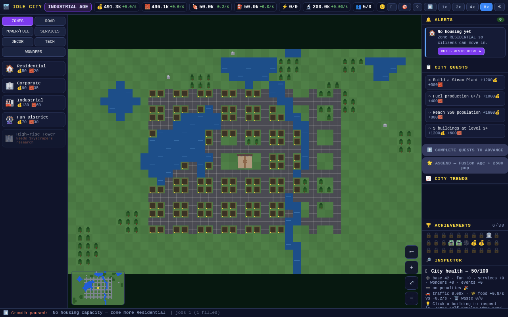
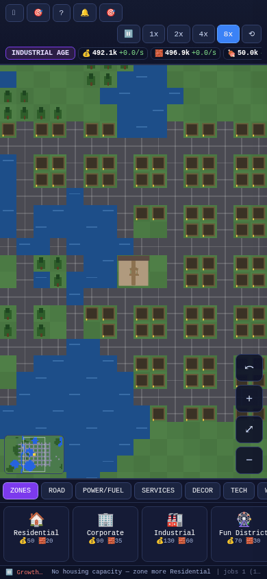
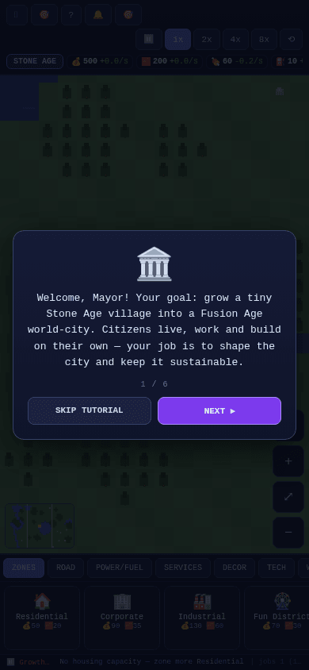
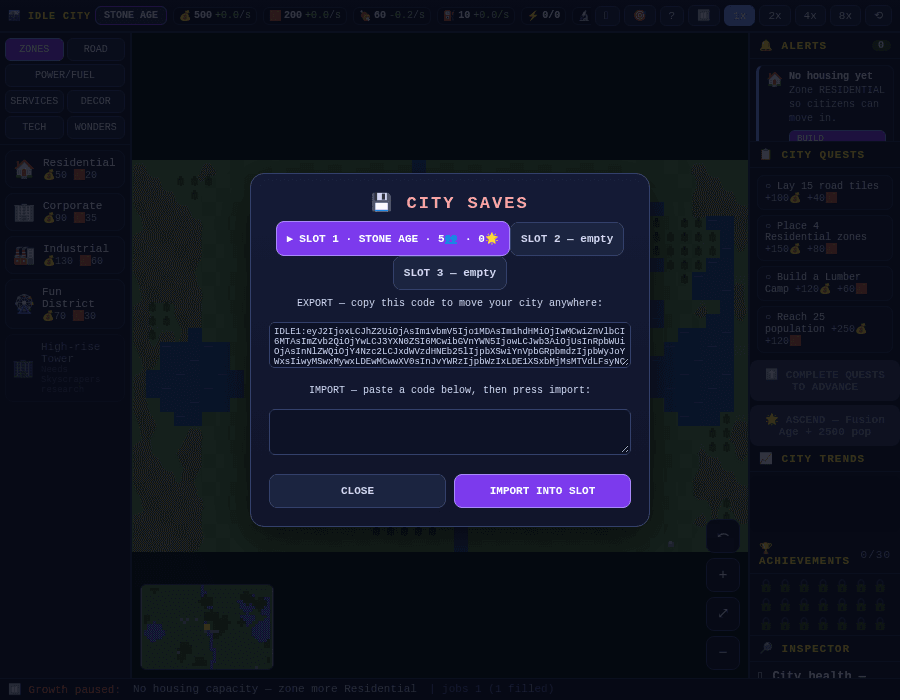

<div align="center">

### 🏙 IDLE CITY — Ages of Growth

**A single-file idle city-builder that grows from a Stone Age village into a Fusion Age world-city.**

[](LICENSE)    

**▶ [Play the live demo](https://drsamonline.github.io/idle-city-ages-of-growth/play/)** &nbsp;·&nbsp; **🌐 [Landing page](https://drsamonline.github.io/idle-city-ages-of-growth/)** &nbsp;·&nbsp; **[Source](https://github.com/drsamonline/idle-city-ages-of-growth)**

**Download:** [Windows (.exe)](https://github.com/drsamonline/idle-city-ages-of-growth/releases/latest/download/idle-city-ages-of-growth-portable.exe) &nbsp;·&nbsp; [Android (.apk)](https://github.com/drsamonline/idle-city-ages-of-growth/releases/latest/download/idle-city-ages-of-growth.apk)

</div>

---

<div align="center">

# 🏙 IDLE CITY — Ages of Growth

**A single-file idle city-builder that grows from a Stone Age village into a Fusion Age world-city.**
Lay roads, zone land, generate power and keep your citizens happy — the city runs itself while you watch, plan and expand.

[](LICENSE)


**Author: [Dr. Sohil Momin](https://github.com/drsamonline)**

</div>

---

<div align="center">




**A single-file idle city-builder that grows from a Stone Age village into a Fusion Age world-city.**

Build roads, zone land, generate power and keep your citizens happy — the city runs itself while you watch, plan and expand.

[](LICENSE)


**Author: [Dr. Sohil Momin](#-credits--attribution)**

</div>

---

## ✨ Features

| | |
|---|---|
| 🏛 **8 Ages of progress** | Stone → Bronze → Iron → Medieval → Industrial → Modern → Digital → Fusion. Each age unlocks buildings, power, fuel and a bigger growth multiplier. |
| 🗺 **Tile city-builder** | Lay roads, zone Residential / Corporate / Industrial / Fun districts, and place utilities, services, decor and world wonders on a procedural 44×28 map. |
| ⚙️ **Living simulation** | Zones self-construct, fill with citizens and level up on their own. Agents drive along your road network. Day/night cycle and weather. |
| ⚡ **Real economy** | Money, Materials, Food, Fuel, Power, Research and Happiness — all connected. Growth pauses the moment something runs short, and the status bar tells you exactly what. |
| 🎯 **Quests, Tech & Challenges** | 36 quests gate the ages, 10 research techs reshape the economy, and 3 timed challenges award medals. |
| 🎲 **Events & disasters** | Festivals, trade booms, migration waves, fires and earthquakes keep a run unpredictable. Citizens also file petitions you can accept or refuse. |
| 💾 **Full save system** | 3 save slots, autosave, and a shareable export/import code to move a city between devices. |
| 🌟 **Ascension** | Reach the Fusion Age at 2,500 citizens to Ascend — carry a permanent Legacy bonus into your next city. |
| 📱 **Fully responsive** | Purpose-built mobile layout with touch pan/pinch-zoom, safe-area support and reachable controls down to 320 px wide. |
| 📦 **Zero dependencies** | One HTML file. No build step to play, no server, no network. Open it and go. |

---

## 🚀 Quick start

**Just play it** — download and open the file in any modern browser:

```
idle-city.min.html      # minified, 81 KB — the one to share
index.html              # readable, 123 KB — same game, un-minified
```

No install, no server, no internet connection required.

### Run locally from source

```bash
git clone https://github.com/drsamonline/idle-city-ages-of-growth.git
cd REPO
# open src/index.html directly, or serve it:
python3 -m http.server 8000
```

### Rebuild the single-file bundles

```bash
npm install                 # dev-only: terser + html-minifier-terser
node build/build.js         # src/  ->  index.html + idle-city.min.html
```

See **[docs/BUILDING.md](docs/BUILDING.md)** for details.

---

## 📸 Screenshots

<div align="center">

| Desktop | Mobile |
|:---:|:---:|
|  |  |
| **Tutorial** | **Save / export** |
|  |  |

</div>

---

## 📂 Project structure

```
.
├── index.html              # ▶ single-file game (readable / un-minified) — GitHub Pages entry
├── idle-city.min.html      # ▶ single-file game (minified, ~34% smaller)
├── src/
│   ├── index.html          # page shell (links style.css + game.js)
│   ├── style.css           # all styles, responsive + mobile layout
│   └── game.js             # the entire game engine
├── build/
│   └── build.js            # inlines + minifies src/ into the two single-file builds
├── docs/
│   ├── GAMEPLAY.md         # how to play, economy, ages, quests
│   ├── ARCHITECTURE.md     # how the engine is put together
│   ├── BUILDING.md         # dev setup, build pipeline, badges
│   └── FAQ.md
├── assets/                 # screenshots used by this README
├── .github/
│   ├── ISSUE_TEMPLATE/     # bug + feature issue templates
│   ├── PULL_REQUEST_TEMPLATE.md
│   └── workflows/build.yml # CI: fails if the bundles drift from src/
├── package.json            # dev scripts + dev-only dependencies
├── README.md
├── LICENSE                 # MIT — © Dr. Sohil Momin
├── ATTRIBUTION.md          # original author + third-party notices
├── CHANGELOG.md
├── CONTRIBUTING.md
├── CODE_OF_CONDUCT.md
└── SECURITY.md
```

---

## 🎮 How to play (30 seconds)

1. **Lay roads** outward from the Town Hall — buildings only work when a road reaches them.
2. **Zone land** with the ZONES tab. Residential houses citizens, Corporate gives jobs and income, Industrial makes materials, Fun raises happiness.
3. **Watch the status bar.** It always says what is blocking growth (no housing, no power, no fuel, unhappy citizens…).
4. **Complete quests** to **Advance Age** and unlock the next era.
5. **Don't let happiness hit zero** — that's game over.

Full guide: **[docs/GAMEPLAY.md](docs/GAMEPLAY.md)**

---

## 🛠 Tech

Plain **HTML + CSS + vanilla JavaScript** on a single `<canvas>`. No frameworks, no bundler, no runtime libraries — the whole game is one script that renders a tile map with a pre-rendered terrain layer and culled building draws, simulated on a fixed-tick loop.

Architecture notes: **[docs/ARCHITECTURE.md](docs/ARCHITECTURE.md)**

---

## 🤝 Contributing

Contributions are welcome — bug reports, balance tweaks, new buildings, translations, accessibility fixes. Please read **[CONTRIBUTING.md](CONTRIBUTING.md)** and the **[Code of Conduct](CODE_OF_CONDUCT.md)** first.

---

## 📜 Credits & attribution

**Original author and creator: Dr. Sohil Momin.**

This project — the game design, code and artwork — is his work. It is released as **source-available**
under the **[PolyForm Noncommercial License 1.0.0](LICENSE)**, with two conditions you must respect:

1. **Attribution is mandatory.** Every copy, fork and **derivative work must credit the author,
   Dr. Sohil Momin, and link the original repository** — https://github.com/drsamonline/idle-city-ages-of-growth.
   This is enforced through the licence's `Required Notice` mechanism.
2. **Commercial use requires a separate licence.** Using this project, or any derivative of it,
   for a commercial purpose is **not permitted** without a written commercial licence obtained
   from the author.

Free to use, study, modify and share for personal, educational, hobby and other non-commercial
purposes. See **[ATTRIBUTION.md](ATTRIBUTION.md)** for full credits and third-party notices.

---

## 📄 Licence

Released under the **[PolyForm Noncommercial License 1.0.0](LICENSE)** — © 2026 Dr. Sohil Momin.

| | |
|---|---|
| :white_check_mark: **Free for non-commercial use** | Personal, hobby, study, teaching, research, non-profits, charities, government. |
| :memo: **Attribution required** | Credit **Dr. Sohil Momin** and link the **[original repository](https://github.com/drsamonline/idle-city-ages-of-growth)** in every copy and derivative work. |
| :briefcase: **Commercial use** | Requires a **separate paid licence** — request one via the repository. |
| :warning: **No warranty** | Provided "as is", without warranty of any kind. |

> Because commercial use is restricted, this is *source-available* rather than OSI-approved
> open source. The full legal text is in **[LICENSE](LICENSE)**.

<div align="center"><sub>Built with ❤ — one file, no dependencies, endless cities.</sub></div>
